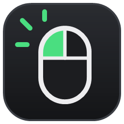
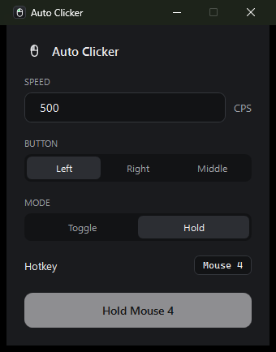

<p align="center"></p>

<h1 align="center">Auto Clicker</h1>

A Windows auto clicker with a dark, minimalist interface that goes well past **1,000 clicks per second** (up to 50,000).

<p align="center"></p>

## Download

Grab `AutoClicker.exe` from the [Releases](../../releases/latest) page. No install needed: just run it.

## Features

- 1 to 50,000 CPS, with a live real-CPS counter
- Left, right or middle mouse button
- **Toggle** and **Hold** modes
- Global hotkey (F6 by default), including mouse side buttons (Mouse 4/5)
- Settings saved to `%AppData%\AutoClicker\settings.json`

## Build

Requires the [.NET 8 SDK](https://dotnet.microsoft.com/download/dotnet/8.0).

```powershell
dotnet test
dotnet publish src\AutoClicker -c Release
```

The single-file executable ends up in `src\AutoClicker\bin\Release\net8.0-windows\win-x64\publish\AutoClicker.exe`.
